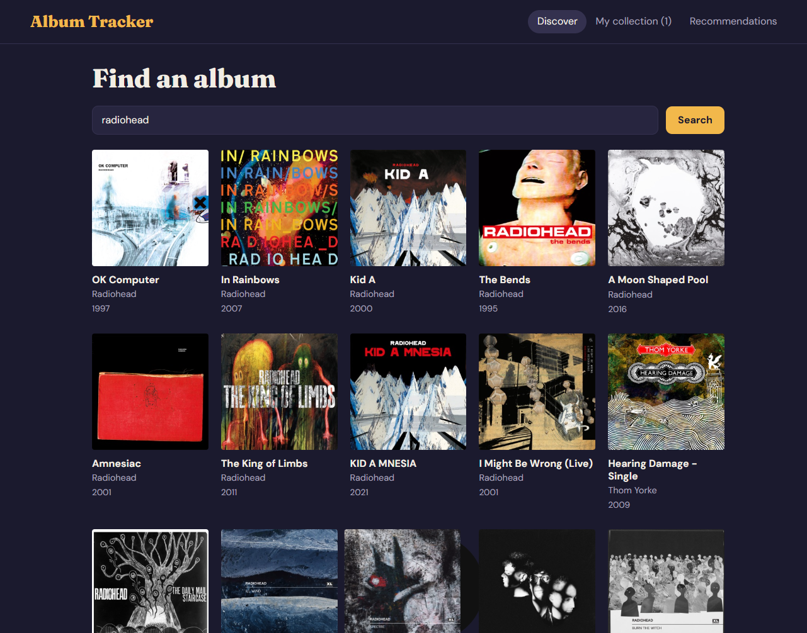
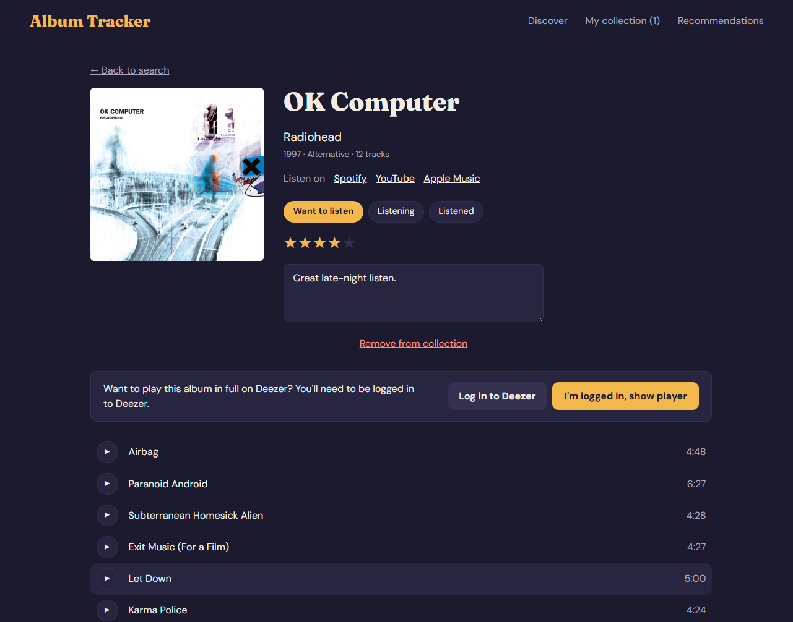
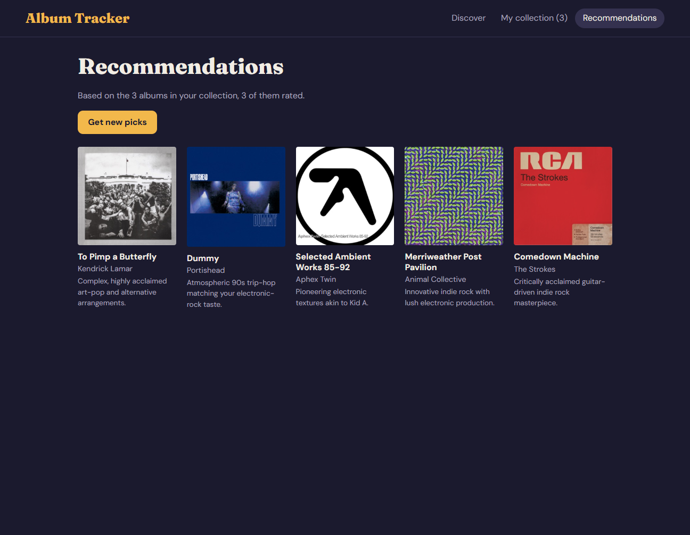

# Album Tracker

I made this for the React lab: an app where you search for albums, listen to
previews, and keep track of what you want to hear and what you thought of it.
Searching uses the iTunes API, and clicking a result opens the album with its
cover, year, genre and track list. You can play the 30 second clips in a small
player that stays at the bottom while you look around. Saved albums go into My
collection with a status, a star rating and some notes, and they survive a
refresh. For popular albums the Deezer lookup usually finds a match, and then you
get a full album player instead of the previews. The Recommendations tab sends
the albums you saved and your ratings to Gemini, and it shows six albums that are
not in your collection yet.



**Live site:** https://album-tracker-six.vercel.app
**GitHub:** https://github.com/darrelle01/album-tracker

## Features

- Search the iTunes catalogue and get up to 24 album cards per search. No key is
  needed for this one.
- Album page with the big cover, artist, year, genre, track count and the track
  list, plus links to Spotify, YouTube and Apple Music.
- 30 second previews with play, pause, next, previous and a seek bar. The player
  keeps playing when you go back to search or open your collection.
- My collection: save an album as want to listen, listening or listened, give it
  1 to 5 stars and write notes. You can filter by status, search by title or
  artist, and sort by title, artist or rating.
- The collection is stored in `localStorage`, so it is still there after a
  refresh or a restart.
- Deezer lookup through a serverless function. If it finds a confident match you
  get the embedded Deezer player, otherwise the preview list stays.
- Recommendations through a serverless function that asks Gemini for ideas based
  on your ratings. Each idea is then searched on iTunes, so albums that do not
  really exist get dropped.

## Tech stack

React, Vite, Context API, iTunes Search API, Deezer, Gemini, Vercel.

## Run it locally

```bash
git clone https://github.com/darrelle01/album-tracker.git
cd album-tracker
npm install
```

Make a `.env.local` file in the project root, next to `package.json`, and put
your Gemini key in it:

```dotenv
GEMINI_API_KEY=your-key-here
```

You can create a free key at [Google AI Studio](https://aistudio.google.com).
Then run the dev server and open http://localhost:5173:

```bash
npm run dev
```

## Screenshots

| Search | Album page | Recommendations |
| --- | --- | --- |
|  |  |  |

## Limitations

- Previews are 30 seconds because that is all the iTunes API gives you.
- The collection is only saved in this browser's `localStorage`, so it does not
  move to another device or another browser.
- Deezer full playback only works if you are logged in to Deezer in the same
  browser. Otherwise it plays previews.

## Privacy note

When you ask for recommendations, the app sends the titles, artists, ratings and
statuses of up to 40 saved albums to Google's Gemini API. Your notes are not
sent. The key is kept in a Vercel environment variable and is read by the
serverless function, so it never ends up in the React code.

This is a class project. It is not affiliated with Apple, Spotify, Deezer or
Google, and the music, artwork and audio belong to their owners.
